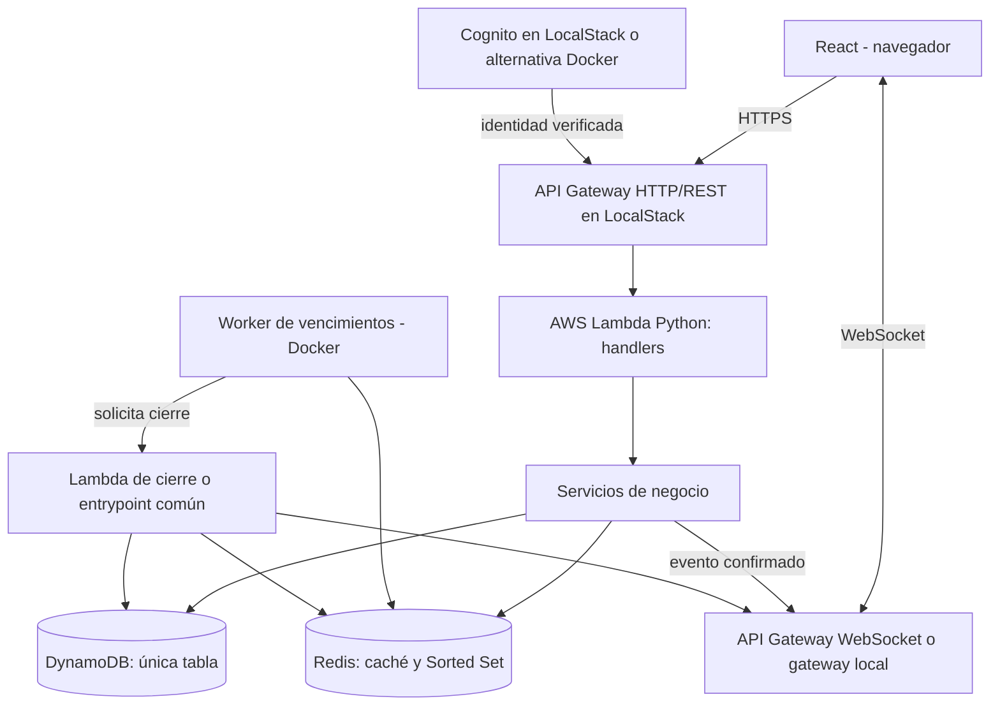

# FlashBid — Especificación técnica MVP 1

> **Actualización posterior — reglas confirmadas del spec 06:** la primera puja debe ser un entero positivo estrictamente superior al precio inicial; el líder no puede volver a pujar hasta que otro usuario lo supere; la idempotencia se conserva durante siete días desde la aceptación. Estas decisiones prevalecen sobre propuestas anteriores en este documento. Ver [spec 06](../specs/06-pujas-reservas.md).


**Estado:** alcance funcional aprobado (27 decisiones) · **Modalidad:** proyecto académico local · **Horizonte:** 7 días de desarrollo · **Fecha de consolidación:** 13 de noviembre de 2026

> **Propósito.** Extender el proyecto de referencia de Bases de Datos NoSQL de la Universidad del Magdalena para construir un marketplace **simulado** de subastas rápidas. No hay dinero real, compraventa efectiva, envíos ni entregas. Los productos se publican únicamente como elementos ficticios para practicar DynamoDB, Redis, funciones Lambda y arquitectura serverless.

**Repositorio de partida:** https://gitlab.com/caov_unimag/bd_no_sql

## 1. Objetivo, criterios de éxito y restricciones

Un usuario autenticado puede publicar un producto ficticio; otros usuarios pueden ofrecer créditos virtuales y recibir actualizaciones en tiempo real. Cada subasta dispone de **120 segundos para su primera puja**. Tras recibirla, cada puja válida establece un vencimiento **20 segundos después**. Si no hay nuevas pujas, se declara ganador al último líder y se transfieren sus créditos reservados al vendedor.

El MVP se considera entregado si el flujo completo funciona en Docker + LocalStack (o un sustituto local documentado para los servicios no emulados), con pruebas automatizadas, justificación de Single Table Design y Cache-Aside, diagramas, guías de ejecución y demostración reproducible.

**Restricciones confirmadas:** una semana; frontend React; backend Python; AWS CDK en Python; API Gateway + AWS Lambda; DynamoDB como fuente de verdad; Redis como caché y sistema auxiliar de vencimientos; Docker Compose; LocalStack **sin AWS real**; código adaptado a la estructura del repositorio académico. Ningún usuario puede pujar en su propia subasta. No existe rol de administrador.

## 2. Decisiones confirmadas

| Nº | Decisión | Alcance aprobado |
|---|---|---|
| 1 | Marketplace | Un mismo usuario puede vender y participar en subastas ajenas. |
| 2 | Simulación | Productos, créditos y resultados ficticios, sin pagos reales. |
| 3 | Billetera inicial | 10.000 créditos por usuario, acreditados una sola vez. |
| 4 | Reserva | La oferta líder reserva saldo; al ser superada se libera; al ganar se transfiere. |
| 5 | Temporización | 120 s hasta la primera oferta; luego 20 s desde cada oferta válida, prorrogables. |
| 6 | Montos | Incrementos libres: cada oferta debe superar la líder; créditos enteros positivos. |
| 7 | Tiempo real | WebSockets para nuevas pujas y cambios de estado. |
| 8 | Identidad | Cognito emulado como primera opción; email y contraseña. |
| 9 | Publicación | Título, descripción, categoría, precio inicial y URL pública de imagen. |
| 10 | Cancelación | Solo por el vendedor y antes de la primera puja. |
| 11 | Liquidación | 100 % de los créditos al vendedor, sin comisión. |
| 12 | Cierre | Sorted Set Redis + worker Docker; verificación final en DynamoDB. |
| 13 | Caché | Cache-Aside para lectura de subastas; invalidación ante cambios. |
| 14 | Frontend | Login, catálogo, publicación, pujas, billetera, movimientos, historial, mis subastas, victorias. |
| 15 | Auditoría de pujas | Cada puja aceptada es un ítem propio en DynamoDB. |
| 16 | Datos | Single Table Design con PK, SK y GSI necesarios. |
| 17 | Pruebas | Unitarias, integración local y escenarios concurrentes. |
| 18 | Roles | Un tipo de usuario; permisos por identidad y propiedad. |
| 19 | Movimientos | Saldos disponible/reservado más reservas, liberaciones y transferencias. |
| 20 | Reconexión | WebSocket con reconexión automática y resíncronización HTTP. |
| 21 | Demo | Script Python idempotente para cuentas, billeteras y publicaciones ficticias. |
| 22 | Organización | Módulos con handlers Lambda, servicios y repositorios. |
| 23 | Entorno | Docker Compose + CDK + scripts automatizados. |
| 24 | Proceso | Desarrollo incremental vertical, frontend/backend integrados desde el inicio. |
| 25 | Emulación | AWS emulado prioritario; alternativas Docker cuando sean necesarias. |
| 26 | Idempotencia | `requestId` persistido en la misma transacción que acepta la puja. |
| 27 | Entregable | MVP funcional, pruebas, documentación, diagramas, Single Table Design, Cache-Aside y guía Docker. |

**Regla complementaria confirmada:** las subastas sin ninguna puja vencen a los 120 s, desaparecen de las respuestas y se eliminan físicamente **más tarde** mediante DynamoDB TTL. Al entrar la primera puja válida, se retira el atributo TTL del ítem de subasta en la misma transacción.

## 3. Estados y reglas del dominio

### 3.1 Estados

- `ACTIVE_NO_BIDS`: subasta abierta sin ofertas; vence 120 segundos después de publicar.
- `ACTIVE_BIDDING`: al menos una puja válida; vence 20 segundos después de la última aceptada.
- `CANCELLED`: cancelación por vendedor antes de cualquier puja.
- `FINISHED`: cerrada con ganador y transferencia confirmada.
- **Sin pujas vencida:** el ítem permanece físicamente hasta que TTL lo borre; para el sistema está expirado cuando `now >= expiresAt`. **No** exponerlo como activo. En caso de querer registrar explícitamente un estado `EXPIRED_NO_BIDS`, debe hacerlo un proceso adicional, pero no es obligatorio en MVP.

### 3.2 Reglas de puja

1. La subasta existe, está activa y `now < expiresAt` según el reloj del backend (UTC). Igualdad al vencimiento implica rechazo.
2. El participante autenticado es distinto del vendedor.
3. El importe es un entero positivo y supera la oferta líder. Para la **primera** puja, el importe debe ser **al menos** el precio inicial publicado (convención propuesta, revisar al implementar).
4. El participante tiene saldo disponible suficiente para la nueva reserva; **no** puede reutilizar saldo reservado en otras subastas.
5. La transacción atómica incluye: condición de versión/estado/vencimiento, cambio de líder y vencimiento, ajuste de las billeteras afectadas, registro inmutable de la puja, movimientos e idempotencia. El TTL de la subasta se retira al aceptar su primera puja.
6. Solo después del éxito de DynamoDB se invalida la caché, se actualiza el Sorted Set y se emite la notificación WebSocket. Si falla Redis o WebSocket, **no** se revierte una puja válida: se recupera por sincronización/reconciliación.
7. Una puja se procesa una sola vez por combinación de identidad + `requestId`. El mismo identificador con un cuerpo diferente se rechaza; un reintento legítimo devuelve el resultado original cuando sea recuperable.
8. Los empates en importe se rechazan (el requisito es **superar**, no igualar).

**Aspectos por implementar con una convención explícita, no previamente decididos:** prohibir que el líder actual se supere a sí mismo (recomendado); monto mínimo de la primera oferta igual al precio inicial; paginación y límites de tamaño; URL de imagen válida; límites razonables por usuario. No se presentan como decisiones del usuario.

### 3.3 Reservas y liquidación

Billetera: `availableCredits` y `reservedCredits`; total propio = suma de ambos. Una reserva traslada importe de disponible a reservado. Cuando otro usuario supera la oferta, se devuelve el reservado anterior al disponible; el nuevo líder reserva su monto completo. Al cerrar:

- La cantidad ganadora sale del **saldo reservado** del comprador, no vuelve a descontarse del disponible.
- Esa misma cantidad se suma al disponible del vendedor.
- Se guarda `winnerUserId`, `winningBidId`, `winningAmount`, `finishedAt` y `settlementId`.
- **Cerrar dos veces debe ser inocuo**: condicionar el cambio de estado `ACTIVE_BIDDING -> FINISHED` y registrar la transferencia en la misma operación transaccional.
- No hay entrega física; la UI muestra “Subasta ganada (simulación)”.

**Invariante:** si se ignora el crédito inicial otorgado a nuevas cuentas, la suma global de saldos disponibles + reservados no cambia por reservar, liberar o liquidar. Probarlo en tests.

### 3.4 Cierre temporal y eliminación

- Publicación: `expiresAt = createdAt + 120s`; `ttl = expiresAt` **solo** para el registro que debe desaparecer si no hay pujas.
- Primera puja: transacción que exige `now < expiresAt`, marca `ACTIVE_BIDDING`, elimina `ttl`, registra líder y asigna `expiresAt = acceptedAt + 20s`.
- Siguientes pujas: `expiresAt = acceptedAt + 20s`.
- Worker: lee los elementos con score vencido del Sorted Set, solicita cierre; cierre consulta DynamoDB y verifica estado + `expiresAt <= now` antes de liquidar. Un evento viejo del worker no puede cerrar una subasta que fue prorrogada.
- Si Redis o el worker se reinician, recomponer vencimientos `ACTIVE_BIDDING` mediante una consulta indexada en DynamoDB. Si Redis está inaccesible, el backend debe seguir validando pujas desde DynamoDB; la liquidación puede quedar pendiente hasta recuperación.
- Subastas sin puja: invisibles desde el segundo 120 independientemente de si TTL borró el ítem; no usaremos TTL como cronómetro exacto. AWS advierte que la eliminación por TTL puede tardar días, por lo que la prueba de interfaz y expiración no debe basarse en la supresión física inmediata.

## 4. Arquitectura



**Separación de responsabilidades:** Lambda maneja HTTP / conexión WebSocket; servicios validan reglas; repositorios aplican transacciones y consultas; Redis acelera lectura y detecta vencimientos; DynamoDB decide ofertas, créditos y ganadores. La gestión de conexión WebSocket se diseña como adaptador intercambiable.

**Riesgo principal:** los servicios Cognito y API Gateway V2/WebSocket del LocalStack efectivamente instalado pueden requerir otro plan/licencia o no cubrir el flujo entero. Un sustituto local para identidad (p. ej. Keycloak) o para WebSocket (p. ej. FastAPI) está permitido, **si se documenta el motivo y se conservan contratos y autorización**. No sustituir Lambda, DynamoDB ni Redis salvo impedimento académico expresamente revisado.

## 5. DynamoDB Single Table Design — borrador orientado a accesos

Tabla sugerida `FlashBidTable` con `PK` y `SK` string; un atributo numérico opcional `ttl` habilitado a nivel tabla. Todos los registros pertenecen a la **misma tabla**. Los nombres de atributos GSI se definirán en CDK.

| Tipo | PK | SK | Atributos destacados |
|---|---|---|---|
| Usuario | `USER#<uid>` | `PROFILE` | `email`, `displayName`, `createdAt` |
| Billetera | `USER#<uid>` | `WALLET` | `availableCredits`, `reservedCredits`, `version` |
| Movimiento | `USER#<uid>` | `MOVEMENT#<timestamp>#<id>` | `type`, `amount`, `auctionId`, `relatedUserId` |
| Subasta | `AUCTION#<aid>` | `META` | `sellerId`, `status`, `highestBid`, `leaderId`, `expiresAt`, `ttl?`, `version` |
| Puja | `AUCTION#<aid>` | `BID#<timestamp>#<bidId>` | `userId`, `amount`, `requestId`, `acceptedAt` |
| Idempotencia | `USER#<uid>` | `REQUEST#<requestId>` | `auctionId`, `payloadHash`, `result`, `ttl` |

**Importante sobre idempotencia:** un `REQUEST` debe tener duración suficiente para cubrir reintentos razonables; el TTL de este ítem es independiente del TTL de una subasta sin pujas.

### 5.1 Patrones de acceso e índices propuestos

| Patrón | Estrategia |
|---|---|
| Perfil y billetera por usuario | `GetItem` en `USER#uid` con `PROFILE` o `WALLET`. |
| Detalle de una subasta | `GetItem AUCTION#aid / META` (lectura fuerte para validaciones). |
| Historial de pujas de una subasta | `Query PK=AUCTION#aid AND begins_with(SK,'BID#')`, descendente/paginado. |
| Historial de movimientos | `Query PK=USER#uid AND begins_with(SK,'MOVEMENT#')`. |
| Subastas activas | GSI-1 con `GSI1PK=AUCTIONS#ACTIVE` y `GSI1SK=createdAt#aid`; excluir vencidas mediante `expiresAt > now`, aun si el índice está retrasado. |
| Mis subastas | GSI-2 con `GSI2PK=SELLER#uid`, `GSI2SK=createdAt#aid`. |
| Mis victorias | GSI-3 **o** ítems de acceso desnormalizados bajo `USER#uid / WON#timestamp#aid`; comparar costo/duplicación antes de fijar GSI-3. |
| Recuperar subastas para el worker | GSI de estado y vencimiento (`ACTIVE_BIDDING`, score temporal); se puede reutilizar un índice si se modela la clave correspondiente. Evitar `Scan` periódico. |

**Decisión de diseño aún a concretar en ADR:** índices exactos (mínimos), proyecciones, claves compuestas y gestión de cambios de estado. La tabla anterior es un **esquema inicial**, no una promesa de que 2 GSI cubren todos los patrones. Crear un ADR con patrones de acceso, consultas `Query`, límites y costos. GSI devuelve datos eventualmente consistentes; nunca usarlo como fuente para aceptar ofertas ni realizar liquidaciones.

**Precaución de diseño:** la puja, las billeteras y el registro de movimiento deben caber en una operación `TransactWriteItems` (y no exceder sus límites). DynamoDB prohíbe que una transacción modifique dos veces el mismo ítem. Preparar comandos `Update`/`Put` únicos por entidad y simular casos con múltiples reservas del mismo usuario.

## 6. Redis

### 6.1 Cache-Aside

- Clave propuesta: `auction:<id>:snapshot`; TTL de caché corto (p. ej. 3–5 segundos, parámetro configurable).
- `GET /auctions/{id}`: buscar caché; si falla, consultar DynamoDB, validar visibilidad/expiración y almacenar instantánea pública.
- Nueva puja, cancelación o cierre: invalidar inmediatamente `auction:<id>:snapshot`. Para listados indexados usar TTL corto o invalidación identificable; la caché nunca debe permitir una puja tardía.
- **Condición importante:** tras un `cache miss`, una lectura lenta no debe reescribir una versión vieja después de una invalidación. Minimizar riesgo con versiones de instantánea, TTL corto y regla de no usar caché en caminos transaccionales.
- Redis no disponible: lecturas se sirven desde DynamoDB (degradación controlada).

### 6.2 Vencimientos

- Sorted Set `auctions:deadlines`: miembro `auctionId`, score `expiresAt` Unix en milisegundos o segundos (elegir y mantener una sola convención).
- Al confirmar una puja, ejecutar `ZADD` con el vencimiento vigente.
- Worker obtiene IDs vencidos con `ZRANGEBYSCORE`; puede utilizar reclamación atómica para evitar exceso de trabajo, **pero** DynamoDB debe manejar siempre los reintentos y cerrar una sola vez.
- Tras completar cierre: `ZREM`; si el cierre observa `expiresAt` posterior a `now`, actualizar el score con el valor persistido. Redis es un índice reconstruible, no el dueño del estado.
- Un trabajo de reconciliación reconstruye el Sorted Set desde subastas `ACTIVE_BIDDING` persistidas al iniciar el worker y ante errores.

## 7. API HTTP propuesta

> Nombres preliminares; al implementar se deben contrastar con los handlers originales y el esquema de API Gateway.

| Método | Ruta | Función |
|---|---|---|
| GET | `/health` | Salud de la aplicación. |
| GET | `/me` | Perfil y créditos del usuario autenticado. |
| GET | `/me/wallet/movements` | Movimientos paginados. |
| GET | `/me/auctions` | Subastas publicadas por el usuario. |
| GET | `/me/wins` | Subastas ganadas. |
| GET | `/auctions` | Listado paginado de subastas activas. |
| POST | `/auctions` | Crear subasta personalizada. |
| GET | `/auctions/{id}` | Detalle, líder, vencimiento y estado. |
| DELETE | `/auctions/{id}` | Cancelar sin pujas, solo por su vendedor. |
| GET | `/auctions/{id}/bids` | Historial de ofertas aceptadas, paginado. |
| POST | `/auctions/{id}/bids` | Nueva puja: `{ "amount": 2000, "requestId": "uuid" }`. |

**Semántica HTTP:** `401` no autenticado; `403` prohibido; `404` recurso ausente/invisible; `409` oferta obsoleta, subasta vencida, intento duplicado incompatible o conflicto concurrente; `422` importe inválido o saldo insuficiente (el código exacto es decisión de implementación). No confiar en el `userId` recibido del cliente: extraer identidad de token validado. Devolver errores estructurados con código, mensaje y contexto seguro.

## 8. Eventos en tiempo real

Canal por subasta (suscripción autorizada). Eventos propuestos:

| Evento | Información |
|---|---|
| `auction.bid_accepted` | `auctionId`, `bidId`, `amount`, `leaderId` público/alias, `expiresAt`, `version` |
| `auction.finished` | `auctionId`, `winnerUserId`/alias, `winningAmount`, `version` |
| `auction.cancelled` | `auctionId`, `version` |

El cliente sincroniza primero por HTTP, establece o recupera WebSocket y aplica eventos solo si la versión supera la actualmente mostrada; si hay duda o pérdida de eventos, solicita el estado vigente por HTTP. Reconexión con backoff, sin asumir que la recepción de mensajes es exactamente una vez.

**Cierre confiable:** si el commit transaccional termina y el envío WebSocket falla, la consulta HTTP debe recuperar el resultado. Un outbox/reintentos persistentes sería una mejora posterior; el MVP no promete entrega garantizada de cada notificación.

## 9. Frontend React — pantallas mínimas

1. **Autenticación:** registro, login y logout; manejo de sesión.
2. **Explorar:** tarjetas con imagen, precio, mayor puja y tiempo restante; solo subastas vigentes.
3. **Detalle:** temporizador sincronizado, historial paginado, formulario para pujar, mensajes de error y estados finales.
4. **Crear:** título, descripción, categoría, precio inicial, URL de imagen; publicación inmediata.
5. **Mis subastas:** en curso/finalizadas/canceladas; acción de cancelar solo si no hay pujas.
6. **Billetera:** saldo disponible, reservado y movimientos recientes.
7. **Mis pujas y victorias:** historial propio y subastas ganadas.

Se priorizan accesibilidad básica, estados de carga/error, actualización de cronómetro local basada en `expiresAt` del servidor y revalidación al reconectar. **No incluir** pagos, envíos, chat, filtros avanzados, rankings, administración ni bots permanentes.

## 10. Organización del repositorio — extensión propuesta

El repositorio público contiene en su árbol `app/infra/app.py`, `app/infra/stack.py`, `app/lambdas/items/handler.py`, `app/lambdas/items/cache.py`, `app/lambdas/health/handler.py`, `docker-compose.yml`, `Dockerfile`, `app/requirements.txt` y pruebas en `tests/`. El proyecto base ya crea una tabla con PK/SK e implementa consultas Cache-Aside. Se debe **extender**, no descartar indiscriminadamente, el trabajo de referencia.

```text
bd_no_sql/
├── docker-compose.yml           # ampliar: worker y frontend
├── Dockerfile                   # conservar/ajustar cdk-dev
├── .env.example                 # valores locales sin secretos reales
├── README.md                    # guía general y diferencias con plantilla
├── app/
│   ├── infra/
│   │   ├── app.py
│   │   └── stack.py             # tabla, TTL, índices, Lambdas, API, identidad y WS si aplica
│   ├── lambdas/
│   │   ├── health/
│   │   ├── auctions/
│   │   ├── bids/
│   │   ├── wallet/
│   │   ├── users/
│   │   └── websocket/
│   ├── modules/                 # código Python compartido
│   │   ├── auctions/{service,repository,models}.py
│   │   ├── bids/{service,repository,models}.py
│   │   ├── wallets/{service,repository,models}.py
│   │   └── shared/{auth,dynamodb,redis_client,errors}.py
│   └── requirements.txt
├── worker/
│   ├── main.py                  # detector y reconciliador de vencimientos
│   └── Dockerfile
├── frontend/                     # React (Vite + TypeScript, sugerencia)
├── scripts/
│   ├── setup-local.sh           # arranque / despliegue coordinado
│   └── seed_demo.py             # idempotente
├── tests/
│   ├── unit/
│   ├── integration/
│   └── concurrency/
└── docs/
    ├── specification.md
    ├── access-patterns.md
    ├── architecture.md
    ├── testing.md
    ├── local-setup.md
    └── adr/
```

**Atención al empaquetado:** no basta con añadir `app/modules/`: las Lambdas deben llevar también el código compartido al desplegarse en LocalStack. Ajustar el mecanismo de bundling del `stack.py` original o generar assets con la estructura correcta.

## 11. Contenedores y despliegue local

Contenedores previstos: `emulador` (LocalStack), `redis`, `cdk-dev`, `worker`, `frontend`. Un servicio adicional de autenticación o WebSocket se agregará **solo si la emulación falla o la edición no lo cubre**. El `docker-compose.yml` original usa `localstack/localstack:4.14`, Redis 7 y `cdk-dev`, y la lista `SERVICES` está limitada; será necesario incluir los servicios requeridos y verificar licencias/compatibilidad antes de implementar toda la ruta.

Secuencia pretendida del script `setup-local.sh`:

1. Comprobar Docker/Compose, variables y estado de puertos.
2. Levantar LocalStack y Redis; esperar healthchecks.
3. Ejecutar `cdklocal bootstrap/deploy` desde `cdk-dev` sin duplicar recursos.
4. Obtener los endpoints generados y escribir configuración **local** de frontend/worker.
5. Sembrar cuentas y productos demo de manera idempotente.
6. Arrancar/reiniciar worker y frontend; verificar health y una lectura de DynamoDB.

El README debe explicar cómo iniciar, parar, limpiar datos voluntariamente, ejecutar pruebas, acceder al frontend y visualizar la API y Redis. No prometer que `docker compose up` por sí solo despliega CDK hasta que ese mecanismo haya sido implementado y probado.

## 12. Pruebas y criterios de aceptación

### Unitarias (`pytest`)

- La primera puja respeta el precio inicial y el plazo de 120 segundos.
- Las siguientes pujas deben superar al líder y renovar exactamente 20 segundos.
- El vendedor no puede pujar; la cancelación solo procede sin ofertas.
- Una billetera no reserva más de su disponible; liberación y liquidación conservan saldos.
- Los timestamps y límites se calculan en UTC; igualdad exacta al vencimiento rechaza la operación.

### Integración (LocalStack + Redis)

- Registro/login y extracción de identidad con el adaptador elegido.
- Publicación/consulta, GSI, Query por PK/SK, historial y movimientos.
- Transacciones en DynamoDB, rollback si falla cualquier condición y deduplicación `requestId`.
- Cache hit/miss/invalidation y fallback sin Redis.
- Sorted Set, worker y recuperación tras reinicio; URL WebSocket y reconexión, si se soporta.
- TTL configurado y atributo numérico guardado; **no exigir borrado físico a los 120 segundos**.

### Concurrencia

- Dos clientes distintos ofrecen simultáneamente: no se pierde el líder ni se duplican créditos.
- Dos workers cierran a la vez: una transferencia; un único ganador.
- Misma puja reenviada simultáneamente con el mismo `requestId`: un resultado persistido.
- Puja cerca del vencimiento vs. cierre: gana la transacción legítima que corresponda según condiciones atómicas; nunca subasta cerrada con oferta tardía.
- Reinicio de worker/Redis: reconstrucción de trabajos y cierre de subastas pendientes.
- Invariante global de créditos antes/después de reservas, liberaciones y ventas.

### Demostración del profesor

A) Arranque reproducible; B) alta de usuario demo, 10.000 créditos; C) publicación; D) dos navegadores con WebSocket; E) pujas concurrentes y reinicio de temporizador; F) liberación de líder superado; G) cierre + ganador + transferencia; H) cancelación antes de primera puja; I) expiración de publicación sin ofertas; J) evidencia de Cache-Aside y consultas indexadas.

## 13. Plan de siete días (incremental)

| Día | Entregable integrado | Prueba mínima |
|---|---|---|
| 1 | Revisar/clonar base, Compose/CDK, tabla, PK/SK/GSI y **spike** de Cognito/WS LocalStack. | `health`, despliegue y compatibilidad documentada. |
| 2 | Identidad + perfil + billetera inicial + pantalla React. | Registro y 10.000 créditos sin duplicados. |
| 3 | Crear, listar y consultar subastas; TTL sin pujas; Cache-Aside; React. | Vencimiento lógico tras 120 s. |
| 4 | Pujar con transacción, reservas, historial, requestId, estados de error; React. | Dos pujas concurrentes y saldo correcto. |
| 5 | Redis Sorted Set, worker, reconciliación y liquidación transaccional. | Ganador y transferencia única tras 20 s. |
| 6 | Eventos WebSocket, reconexión, historial y pantallas restantes. | Dos navegadores sincronizados y recuperación tras desconexión. |
| 7 | Pruebas de regresión, scripts seed, diagramas, ADR, documentación y demo. | Ejecutar escenario integral desde entorno limpio. |

**Regla de priorización:** funcionalidad correcta > demostración reproducible > documentación exigida > pulido visual. Si el día 1 la emulación de Cognito/WS no funciona, aplicar de inmediato la alternativa local autorizada, sin posponer la lógica de subastas.

## 14. Riesgos y controles

| Riesgo | Control |
|---|---|
| LocalStack no soporta toda la funcionalidad/plan de Cognito o WebSocket. | Spike el día 1; sustituto Docker mediante adaptador; documentar diferencias. |
| TTL elimina más tarde de lo previsto. | `expiresAt` gobierna visibilidad y validez; TTL solo limpia. |
| Puja válida confirmada pero `ZADD` falla. | Reconciliación worker desde DynamoDB; no revertir puja. |
| Dos escritores aceptan ofertas contradictorias. | `TransactWriteItems` con condición de versión/estado/saldo y reintentos limitados. |
| Reintento repite una operación. | Persistir `requestId` de forma transaccional; retornar resultado existente. |
| Caché atrasada anuncia estado incorrecto. | Invalidación, versión, TTL corto y lectura autoritativa para operaciones críticas. |
| Cierre repetido transfiere dos veces. | Cambio de estado condicionado + transferencia atómica + `settlementId`. |
| Escasa RAM/CPU en entorno Docker. | Reducir servicios opcionales, limitar simultaneidad y medir recursos. |
| Imágenes remotas fallan. | Placeholder React y validación de URL; no almacenar binarios. |

## 15. Entregables de la entrega académica

- Código ampliado desde el repositorio base, con instrucciones claras de qué se conservó y qué se cambió.
- `README.md` de FlashBid, `.env.example` y guía de Docker + CDK + LocalStack.
- Especificación funcional y técnica, diagrama de componentes y secuencias (pujar, cerrar, reconectar).
- Documento `access-patterns.md` con tabla de consultas, PK/SK/GSI y argumentos contra `Scan`.
- ADR de elección DynamoDB source of truth / Redis Cache-Aside + Sorted Sets; ADR de contingencia de emulador.
- `pytest` unitario, integración, concurrencia; comandos reproducibles y evidencias.
- Script demo idempotente y guion de sustentación con dos usuarios.

## 16. Aspectos pendientes de precisión técnica (no constituyen nuevas decisiones aprobadas)

1. Versión/plan concreto de LocalStack y resultado del spike de API Gateway V2 + Cognito + Lambda; confirmar qué puede emular el repositorio **4.14** actual.
2. Esquema exacto de GSI y cómo indexar vencimientos `ACTIVE_BIDDING` sin consultas Scan periódicas.
3. Mecanismo de reconstrucción de los vencimientos cuando Redis pierde estado y mecanismo de invocación del cierre por el worker (Lambda emulada vs importación de servicio compartido).
4. Convenciones de la primera puja, auto-superación del líder, restricciones de longitud y límites de paginación.
5. Diseño del adaptador de WebSockets, autorizaciones y publicación tras un commit.
6. Capacidad de transacciones DynamoDB emuladas frente a AWS; registrar cualquier comportamiento distinto.
7. **No otorgar créditos iniciales dos veces** en el script demo, en callbacks de registro ni en reintentos concurrentes.

---

## Fuentes técnicas

- Proyecto académico, README y requisitos: https://gitlab.com/caov_unimag/bd_no_sql/-/raw/main/README.md
- Infraestructura CDK original: https://gitlab.com/caov_unimag/bd_no_sql/-/raw/main/app/infra/stack.py
- Docker Compose original: https://gitlab.com/caov_unimag/bd_no_sql/-/raw/main/docker-compose.yml
- CRUD inicial y ejemplo Cache-Aside: https://gitlab.com/caov_unimag/bd_no_sql/-/raw/main/app/lambdas/items/handler.py
- AWS DynamoDB TTL: https://docs.aws.amazon.com/amazondynamodb/latest/developerguide/TTL.html
- AWS TTL y elementos vencidos: https://docs.aws.amazon.com/amazondynamodb/latest/developerguide/ttl-expired-items.html
- LocalStack API Gateway (compatibilidad por plan): https://docs.localstack.cloud/aws/services/apigateway/
- LocalStack Cognito (compatibilidad por plan): https://docs.localstack.cloud/aws/services/cognito-idp/

**Naturaleza del documento:** especificación inicial y plan de implementación, no software ya implementado ni garantía de que la edición local de LocalStack incluya todos los servicios.
